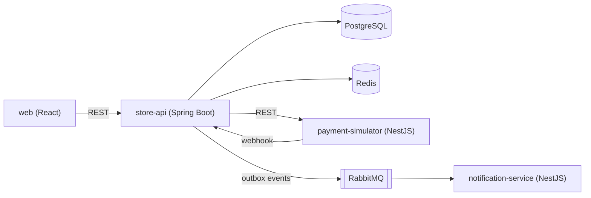

# Plaza Marketplace

Order platform for a marketplace of small merchants: multi-store catalog with full-text search,
cart, checkout that never oversells the last unit, payments confirmed through signed webhooks,
and event-driven notifications.

> **Status:** in development. The live demo, screenshots and the one-command local setup will
> appear here as the [roadmap](docs/ROADMAP.md) progresses.

## What makes it interesting

- **Consistency under concurrency:** stock is reserved with transactional, conditional updates
  in PostgreSQL, proven by concurrency tests and a load test.
- **Idempotent payments:** duplicate webhooks and retried requests change an order only once.
- **Reliable events:** a transactional outbox publishes order events to RabbitMQ without losing
  them.
- **Same deployment from laptop to production:** one Helm chart for kind and for k3s.

## Architecture

Details: [docs/ARCHITECTURE.md](docs/ARCHITECTURE.md).

## Tech stack

Java 25 · Spring Boot 4.1 · NestJS 12 · React 19 · TypeScript · PostgreSQL 18 · Redis 8 ·
RabbitMQ 4 · JUnit 5 · Testcontainers · Playwright · Docker · Kubernetes (kind, k3s) · Helm ·
GitHub Actions

## Documentation

- [Roadmap](docs/ROADMAP.md)
- [Architecture](docs/ARCHITECTURE.md)
- [Architecture decision records](docs/adr/)
- [Progress log](docs/PROGRESS.md)

## License

[MIT](LICENSE)
