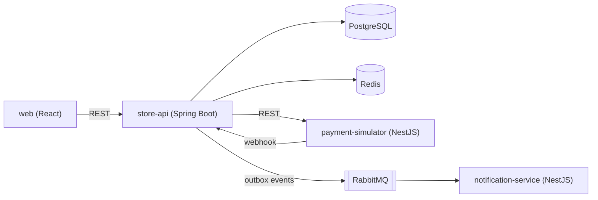

# Plaza Marketplace

Order platform for a marketplace of small merchants: multi-store catalog with full-text search,
cart, checkout that never oversells the last unit, payments confirmed through signed webhooks,
and event-driven notifications.

> **Status:** in development. The live demo, screenshots and the one-command local setup will
> appear here as the [roadmap](docs/ROADMAP.md) progresses.

## What makes it interesting

- **Consistency under concurrency:** stock is reserved with transactional, conditional updates
  in PostgreSQL, proven by concurrency tests and a load test.
- **Idempotent payments:** duplicate webhooks and retried requests change an order only once.
- **Reliable events:** a transactional outbox publishes order events to RabbitMQ without losing
  them.
- **Same deployment from laptop to production:** one Helm chart for kind and for k3s.

## Architecture



Details: [docs/ARCHITECTURE.md](docs/ARCHITECTURE.md).

## Run locally

Requires only Docker (Docker Desktop on Windows and macOS):

```bash
docker compose up --build
```

Then open:

- Web app: <http://localhost:3000>
- Products API: <http://localhost:8080/api/v1/products>
- API docs (Swagger UI): <http://localhost:8080/swagger-ui.html>
- Health: <http://localhost:8080/actuator/health>

The database starts with demo data. Ports and credentials can be changed by copying
`.env.example` to `.env`. On Windows, Docker runs inside WSL 2; if it takes too much memory,
limit it with a `%UserProfile%\.wslconfig` file containing `[wsl2]` and `memory=6GB`.

## Tech stack

Java 25 · Spring Boot 4.1 · NestJS 12 · React 19 · TypeScript · PostgreSQL 18 · Redis 8 ·
RabbitMQ 4 · JUnit 5 · Testcontainers · Playwright · Docker · Kubernetes (kind, k3s) · Helm ·
GitHub Actions

## Documentation

- [Roadmap](docs/ROADMAP.md)
- [Architecture](docs/ARCHITECTURE.md)
- [Architecture decision records](docs/adr/)
- [Progress log](docs/PROGRESS.md)

## License

[MIT](LICENSE)
