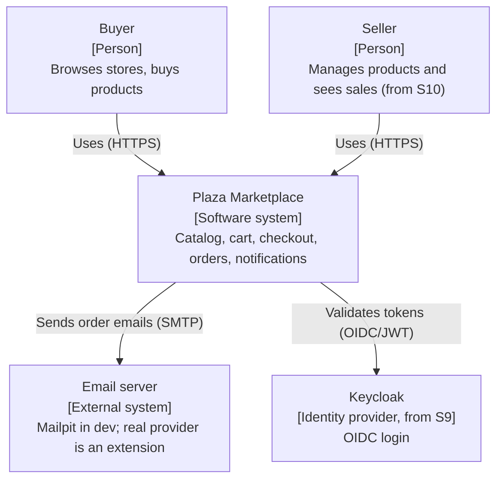
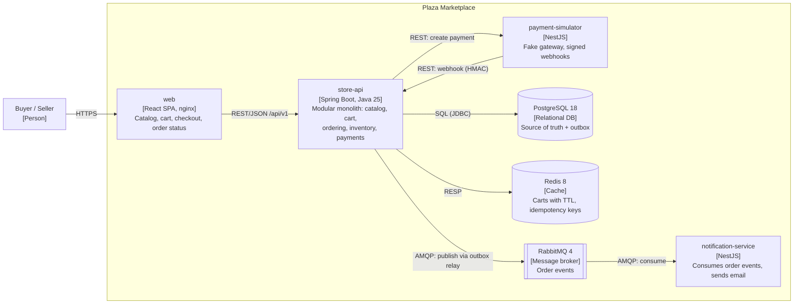
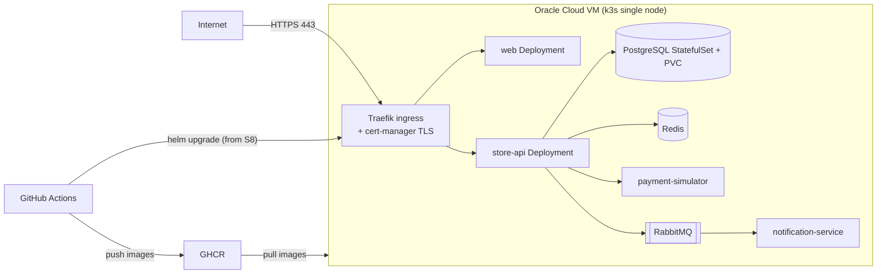
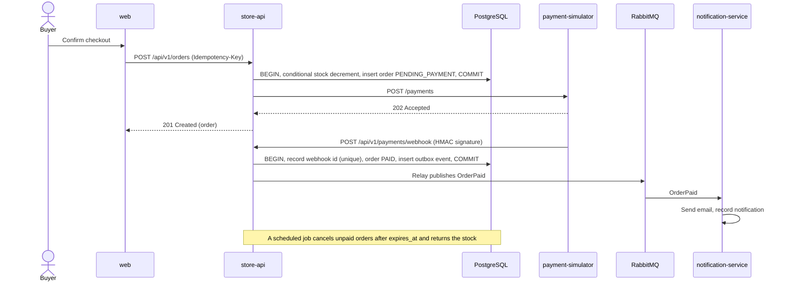
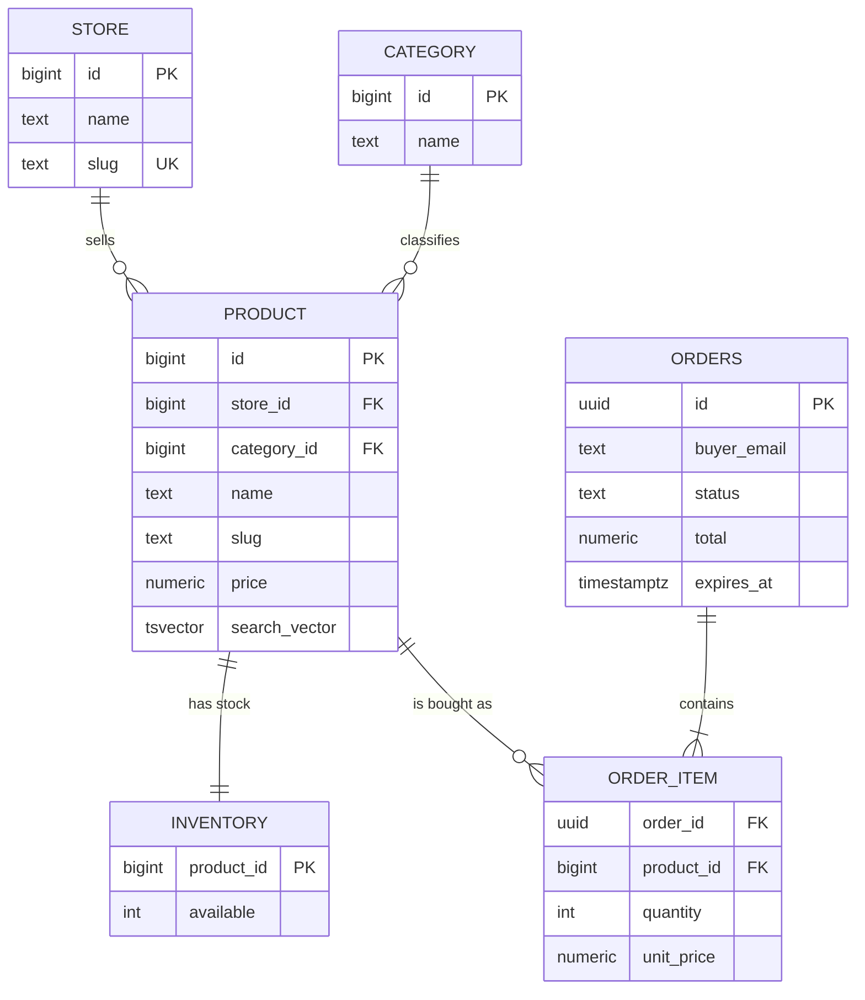

# Architecture

Status: **planned design** (Session 0). Each section is updated when its part is built; mark
anything that changes with a new ADR in `docs/adr/`.

## 1. System context (C4 level 1)



The payment gateway is part of the system on purpose: `payment-simulator` imitates a real
gateway (asynchronous confirmation by signed webhook) so the demo never depends on a third party.

## 2. Containers (C4 level 2)



**Synchronous:** browser to `store-api` (REST), `store-api` to `payment-simulator` (REST), and
the webhook back. **Asynchronous:** order events through RabbitMQ to `notification-service`.

## 3. Deployment

| Environment | How it runs |
|---|---|
| Local dev | `docker compose up` (all containers + Mailpit) |
| Local Kubernetes | kind cluster, Traefik ingress, Helm chart with `values-local.yaml` |
| CI (from S8) | kind cluster inside GitHub Actions, chart installed, smoke tests |
| Production | Single-node k3s on an Oracle Cloud Ampere A1 VM (ARM64, 2 OCPU, 12 GB), Traefik, cert-manager + Let's Encrypt, same chart with `values-prod.yaml` |



## 4. Checkout flow (MVP)



## 5. Initial data model (MVP)



Supporting tables: `outbox_event` (pending events for the relay), `processed_webhook` (unique
webhook ids for idempotency) and `flyway_schema_history`.

## 6. `store-api` modules

One deployable, organized by business module, not by technical layer:

```
catalog/     products, categories, stores, search
cart/        Redis-backed carts
ordering/    orders, checkout, order state machine, expiry job
inventory/   stock and conditional decrement
payments/    payment client and webhook endpoint
shared/      outbox, error handling (problem details), config
```

Rule: a module talks to another only through its public service classes, never through another
module's repositories or tables.
