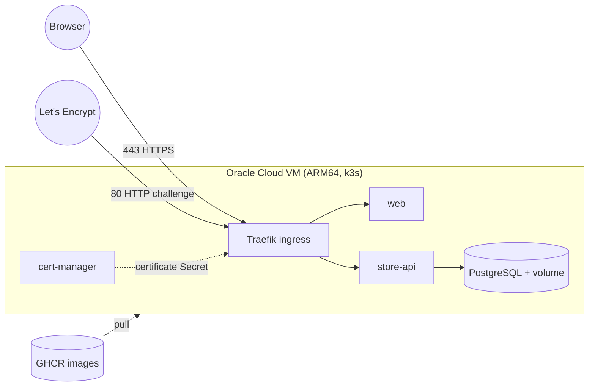

# Production deploy runbook

How to take an empty Oracle Cloud account to `https://<host>` serving Plaza on a single-node
k3s cluster. Why this setup was chosen: [ADR-0004](adr/0004-hosting-k3s-oracle-free.md).

The work is split in two:

- **Once:** sections 1 to 6 (server, firewall, k3s, cert-manager, first deploy).
- **Every release:** section 7 (one `helm upgrade`).

Everything runs **on the server over SSH**. The Kubernetes API port (6443) is never opened to
the internet.



## 0. What you need

| Thing | Notes |
|---|---|
| Oracle Cloud account | Free Tier. Asks for a card to verify identity; Always Free resources are not charged |
| SSH key pair | Created in step 1 if you do not have one |
| A host name | Your own domain, or a free `sslip.io` name (step 3). No registration needed for `sslip.io` |

Nothing in this runbook needs a GitHub token: the repository and the images are public.

## 1. Create the server (Oracle Cloud console)

1. Create an SSH key on your laptop (skip if `~/.ssh/id_ed25519.pub` exists):

   ```bash
   ssh-keygen -t ed25519 -C "plaza-server"
   ```

2. In the console: **Compute > Instances > Create instance**.

   | Field | Value |
   |---|---|
   | Name | `plaza` |
   | Image | Canonical Ubuntu 24.04 (the **aarch64** build) |
   | Shape | Ampere `VM.Standard.A1.Flex`, **2 OCPU, 12 GB** (labelled "Always Free-eligible") |
   | Networking | Create a new virtual cloud network with a **public subnet**; assign a public IPv4 address |
   | SSH keys | Paste the content of `~/.ssh/id_ed25519.pub` |
   | Boot volume | Default size (about 47 GB; the free allowance is 200 GB in total) |

3. If the console answers **"Out of capacity"**, free ARM machines are exhausted in that
   availability domain at the moment. Try another availability domain, or try again later.

4. Write down the **public IP address** of the instance.

5. Check the connection:

   ```bash
   ssh ubuntu@<public-ip>
   ```

## 2. Open ports 80 and 443

Two firewalls sit in front of the application and **both** must allow the traffic.

**Cloud firewall (console).** Instance page > the subnet > its **Security List** >
**Add Ingress Rules**, twice:

| Source CIDR | Protocol | Destination port |
|---|---|---|
| `0.0.0.0/0` | TCP | 80 |
| `0.0.0.0/0` | TCP | 443 |

Port 80 is needed even though the site uses HTTPS: Let's Encrypt validates the host over HTTP,
and browsers that type the plain host name are redirected from 80 to 443.

**Server firewall (SSH).** Oracle's Ubuntu images ship `iptables` rules that reject everything
except SSH:

```bash
sudo iptables -I INPUT 6 -m state --state NEW -p tcp --dport 80 -j ACCEPT
sudo iptables -I INPUT 6 -m state --state NEW -p tcp --dport 443 -j ACCEPT
# Pods and Services talk to each other and to the node over these internal k3s networks.
sudo iptables -I INPUT 6 -s 10.42.0.0/16 -j ACCEPT
sudo iptables -I INPUT 6 -s 10.43.0.0/16 -j ACCEPT
sudo netfilter-persistent save
```

Port 6443 (Kubernetes API) stays closed on purpose.

## 3. Choose the host name

- **Own domain:** create an `A` record pointing to the public IP, for example
  `plaza.example.com -> 203.0.113.10`.
- **No domain:** use `sslip.io`, a free DNS service that resolves any name containing an IP
  address to that address. For the IP `203.0.113.10` the host is
  `plaza.203-0-113-10.sslip.io` (dashes instead of dots).

Check it from your laptop; it must print the server IP:

```bash
nslookup <host>
```

## 4. Install k3s, Helm and cert-manager (SSH)

```bash
# k3s: Kubernetes in one binary. Includes Traefik (ingress) and local-path (volumes).
curl -sfL https://get.k3s.io | INSTALL_K3S_VERSION="v1.37.2+k3s1" sh -

# Let the ubuntu user use kubectl and helm without sudo.
mkdir -p ~/.kube
sudo cp /etc/rancher/k3s/k3s.yaml ~/.kube/config
sudo chown "$USER" ~/.kube/config && chmod 600 ~/.kube/config
echo 'export KUBECONFIG=~/.kube/config' >> ~/.bashrc && source ~/.bashrc

kubectl get nodes                 # STATUS must be Ready
kubectl -n kube-system get pods   # traefik, coredns and local-path-provisioner Running

# Helm
curl -fsSL https://raw.githubusercontent.com/helm/helm/main/scripts/get-helm-4 | bash

# cert-manager: requests and renews the TLS certificates.
helm upgrade --install cert-manager oci://quay.io/jetstack/charts/cert-manager \
  --version v1.21.3 --namespace cert-manager --create-namespace \
  --set crds.enabled=true --wait
```

## 5. Get the repository and create the issuers (SSH)

```bash
git clone https://github.com/AnthonyGonzalez1/plaza-marketplace.git
cd plaza-marketplace
kubectl apply -f deploy/k3s/cluster-issuer.yaml
kubectl get clusterissuer         # both READY True after a few seconds
```

`deploy/k3s/cluster-issuer.yaml` explains how a certificate is issued.

## 6. First deploy (SSH)

1. Create the database password **on the server**. It is never typed in a chat, committed, or
   left in the shell history:

   ```bash
   umask 077
   printf 'postgres:\n  password: "%s"\n' "$(openssl rand -hex 24)" > ~/plaza-secrets.yaml
   ```

   PostgreSQL reads this password only when it initializes an empty volume. Changing the file
   later does **not** change the password of an existing database.

2. Deploy with the **staging** issuer first. Let's Encrypt production has strict rate limits,
   so prove the flow with staging:

   ```bash
   cd ~/plaza-marketplace
   export PLAZA_HOST=<host>                 # from step 3
   export PLAZA_TAG=$(git rev-parse HEAD)   # CI published an image with this tag

   helm upgrade --install plaza deploy/helm/plaza \
     --namespace plaza --create-namespace \
     --values deploy/helm/plaza/values-prod.yaml \
     --values ~/plaza-secrets.yaml \
     --set imageTag="$PLAZA_TAG" \
     --set ingress.host="$PLAZA_HOST" \
     --set ingress.tls.clusterIssuer=letsencrypt-staging \
     --wait --timeout 10m
   ```

3. Check:

   ```bash
   kubectl -n plaza get pods            # three pods Running and READY
   kubectl -n plaza get certificate     # plaza-tls READY True (can take a minute)
   curl -sk "https://$PLAZA_HOST/api/v1/stores"   # -k: staging certificates are not trusted
   ```

4. Switch to the real certificate: run the same `helm upgrade` **without** the
   `--set ingress.tls.clusterIssuer=...` line (the default in `values-prod.yaml` is
   `letsencrypt-prod`). Then, without `-k`:

   ```bash
   kubectl -n plaza get certificate
   curl -s "https://$PLAZA_HOST/api/v1/stores"
   curl -sI "http://$PLAZA_HOST/" | head -3      # 301 redirect to https
   ```

   If the browser still shows the staging certificate, delete the Secret so it is issued
   again: `kubectl -n plaza delete secret plaza-tls`.

5. Open `https://<host>` and `https://<host>/swagger-ui.html` in a browser.

## 7. Deploy a new version

After a pull request is merged, wait for the `images` workflow to finish on `main`, then:

```bash
cd ~/plaza-marketplace && git pull
helm upgrade plaza deploy/helm/plaza --namespace plaza \
  --values deploy/helm/plaza/values-prod.yaml --values ~/plaza-secrets.yaml \
  --set imageTag="$(git rev-parse HEAD)" --set ingress.host="$PLAZA_HOST" \
  --wait --timeout 10m
```

Kubernetes starts the new pods, waits for their readiness probes and only then stops the old
ones. Continuous deployment replaces this manual step in S8.

## 8. Roll back

```bash
helm -n plaza history plaza       # list of releases
helm -n plaza rollback plaza      # back to the previous release
```

A rollback restores the Kubernetes objects and the image tag. It does **not** undo database
migrations: a migration must stay compatible with the previous version of the code.

## 9. When something fails

| Symptom | Look at |
|---|---|
| Pod not `Running` | `kubectl -n plaza describe pod <name>` (Events at the bottom) |
| `ImagePullBackOff` | The tag does not exist: has the `images` workflow finished for that commit? Is the package public? |
| `exec format error` in the logs | The image has no arm64 variant |
| Pod `Running` but not `READY` | `kubectl -n plaza logs <name>`; the readiness probe checks the database |
| Certificate not `READY` | `kubectl -n plaza describe certificate plaza-tls`, then `kubectl -n plaza get challenges`. Usual causes: port 80 closed in one of the two firewalls, or the host does not resolve to the server |
| Site times out from the internet | Both firewalls of section 2 |
| Pods cannot resolve names (`UnknownHostException`) | The server firewall is blocking the pod networks (section 2) |

## 10. Costs and housekeeping

- Always Free resources are not charged, and a Free Tier account cannot be billed unless it is
  upgraded to Pay As You Go. Do not upgrade the account.
- In **Billing & Cost Management > Budgets**, create a budget of USD 1 with an alert at 1 % to
  your email, as a second safety net. It becomes code in S14.
- Oracle may reclaim Always Free instances that stay idle for 7 days (CPU, network and memory
  all under 20 %). Check the instance weekly while the project has little traffic.
- The database lives on the server disk and has no backup yet (planned in S15). Do not delete
  the `data-plaza-postgres-0` volume claim.
- To remove everything: `helm -n plaza uninstall plaza`, then terminate the instance in the
  console (tick "delete boot volume").
