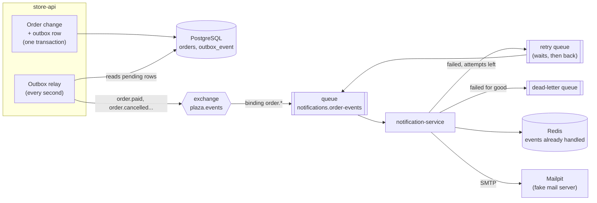

# Events: transactional outbox, RabbitMQ and notifications

When an order is paid or cancelled, the buyer gets an email. The API does not send it: it
announces what happened (an **event**) and a separate service reacts. This document explains
how the announcement is made without ever losing it.

## The flow



## The problem: two systems, no shared transaction

Marking an order as paid happens in PostgreSQL. Announcing it happens in RabbitMQ. Nothing
can commit both at once, so every simple order of operations has a hole:

| Approach | What goes wrong |
|---|---|
| Commit, then publish | The process dies between the two: the order is paid and nobody is ever told |
| Publish, then commit | The commit fails: an email announces a payment that does not exist |

This is the **dual-write problem**.

## The solution: transactional outbox

1. In the **same transaction** that changes the order, the API inserts a row into
   `outbox_event` with the message to send. Both are committed or neither is.
2. A background job, the **relay** (`OutboxRelay`), reads the rows not yet published, sends
   them to RabbitMQ, waits for the broker's confirmation and marks them as published.

If the relay or the broker fails, the rows stay pending and the next run retries. The worst
case is the relay dying after the broker received a message but before marking the row: the
message is sent again. So the guarantee is **at least once**: never lost, sometimes repeated.

Details worth knowing:

- **`FOR UPDATE SKIP LOCKED`**: the relay locks the rows it is publishing. With two instances
  of the API, the second skips the locked rows instead of waiting or publishing them again.
- **Publisher confirms**: sending only puts bytes on the network. The relay waits until
  RabbitMQ answers that it stored the messages before marking the rows.
- **Order**: rows are published by their sequence number, so `OrderPlaced` leaves before
  `OrderPaid`.
- **Partial index** on unpublished rows: the relay's query stays fast however large the table
  grows.

## RabbitMQ in one minute

- A publisher sends to an **exchange** with a **routing key** (`order.paid`). It never knows
  who is listening.
- A consumer owns a **queue** and **binds** it to the exchange with a pattern (`order.*`).
  The exchange copies each matching message into the queue.
- A consumer **acknowledges** (acks) a message when it is done; only then does RabbitMQ delete
  it. If the consumer dies first, the message is delivered again.

Adding a second consumer (for example, analytics) means declaring another queue and binding.
The API does not change.

## The events

Exchange `plaza.events` (topic). The AMQP `messageId` is the event id.

| Type | Routing key | When |
|---|---|---|
| `OrderPlaced` | `order.placed` | Checkout created the order (stock reserved) |
| `OrderPaid` | `order.paid` | The payment was approved |
| `OrderCancelled` | `order.cancelled` | Payment declined (`reason: PAYMENT_DECLINED`) or not paid in time (`EXPIRED`) |

```json
{
  "eventId": "6a1c…",
  "type": "OrderPaid",
  "occurredAt": "2026-11-17T12:00:00Z",
  "order": {
    "id": "0193…", "email": "ana@example.com", "status": "PAID",
    "total": 64000.00, "currency": "COP",
    "items": [{ "productId": 1, "name": "Café molido", "unitPrice": 32000.00, "quantity": 2, "lineTotal": 64000.00 }]
  }
}
```

The event carries the data a consumer needs, so the notification service never calls the API
back.

## The consumer: notification-service

Because delivery is at-least-once, the consumer must cope with repeats and with its own
failures:

- **Idempotent consumer**: before sending an email it claims the event id in Redis
  (`SET ... NX`). If the id was already there, the event is a repeat and is skipped.
- **Retries**: if sending fails (mail server down), the message goes to a **retry queue**
  that holds it for a few seconds and returns it to the main queue.
- **Dead-letter queue (DLQ)**: after the last attempt, or when a message can never be
  processed (invalid JSON), it is parked in a separate queue for a person to inspect, instead
  of blocking the queue or being retried forever.

## Try it locally

```bash
docker compose up --build
```

- Buy and pay something at <http://localhost:3000>, then open the inbox at
  <http://localhost:8025>.
- RabbitMQ management UI: <http://localhost:15672> (user `plaza`, password `plaza`): see the
  exchange, the three queues and the message rates.
- Outbox table:

  ```bash
  docker compose exec postgres psql -U plaza -d plaza \
    -c "SELECT seq, type, routing_key, created_at, published_at FROM outbox_event ORDER BY seq DESC LIMIT 10"
  ```

## Known limits

- `outbox_event` is never cleaned: published rows accumulate. A purge job is future work.
- The relay polls every second, so events leave with up to one second of delay.
- The consumer remembers handled events in Redis for 7 days and Redis has no persistence: a
  Redis restart followed by a repeated delivery could send a second email.
- The event is claimed in Redis *before* the email is sent. A crash after sending and before
  acknowledging is therefore harmless: the redelivered copy finds the claim and is skipped. The
  two remaining gaps: a crash between the claim and the send loses that email (the copy is
  skipped), and a mail server that accepts the email but whose answer never arrives (timeout)
  makes the consumer retry and send it twice.
  Exactly-once delivery does not exist; the goal is at-least-once plus idempotence.
- Emails go to Mailpit, a fake mail server. No real email is sent.
