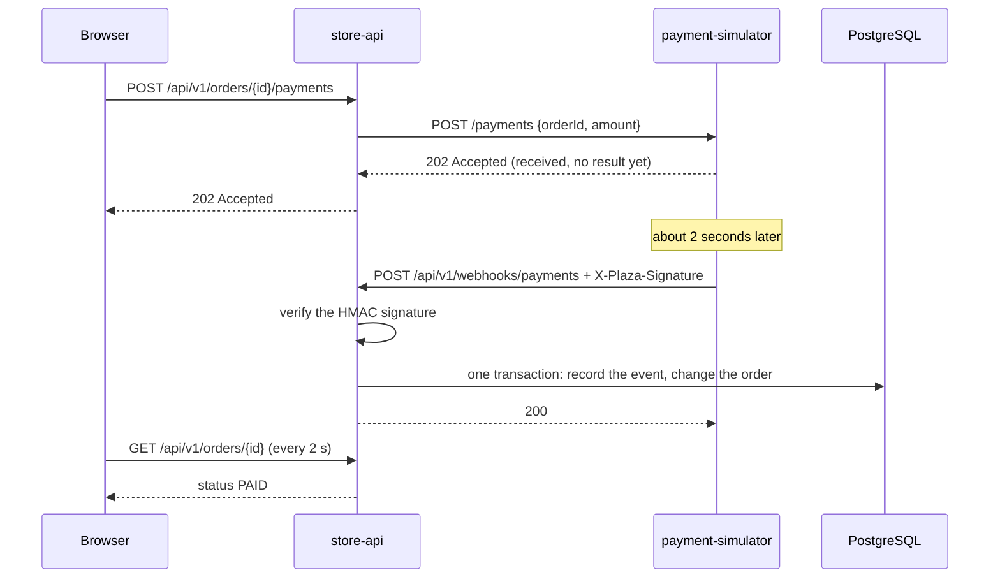
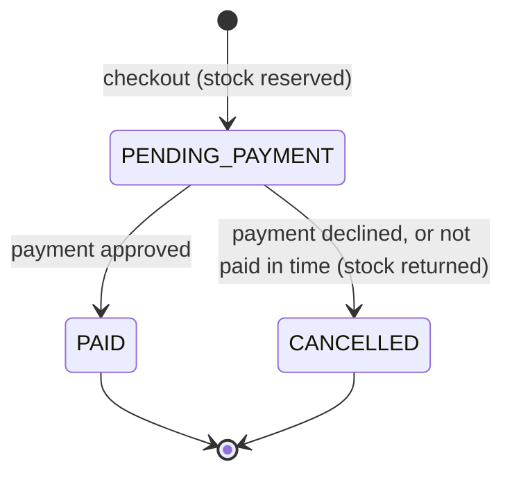

# Payments: asynchronous results, signed webhooks and idempotency

A payment is not decided while the buyer waits. The store asks a payment gateway to charge,
and the gateway tells the store the result later by calling it back. This document explains
how Plaza handles that safely. The gateway here is `services/payment-simulator`, a fake one
that behaves like the real ones (no real money moves).

## The flow



`202 Accepted` means "request received, the result will exist later". The browser learns the
result by asking for the order again (polling).

## Order state machine



Every change is an `UPDATE ... WHERE status = 'PENDING_PAYMENT'`. The condition is the state
machine: an order that already left the pending state cannot change again, and when two
changes race (a payment confirmed at the instant the order expires) the row lock lets one
win and the other finds nothing to update.

## Three problems and their solutions

### 1. Anyone can call the webhook URL: HMAC signature

The webhook endpoint is public. Without protection, anyone could send "order X was paid".

The gateway and the store share a secret. The gateway computes an HMAC-SHA256 of the request
body with that secret and sends it in the `X-Plaza-Signature` header. The store computes the
same value with its copy of the secret and compares.

- A matching signature proves the sender knows the secret **and** the body was not changed.
- The secret never travels, only the fingerprint.
- The signature is checked against the **raw bytes** received, before parsing the JSON.
- The comparison takes constant time (`MessageDigest.isEqual`), so response times do not
  reveal how much of a forged signature was right.

### 2. The same webhook can arrive twice: deduplication

Gateways deliver **at least once**: if they do not see a `2xx` answer (a timeout, a restart),
they send the event again. Handling a "declined" event twice would return the stock twice.

Each event has an `eventId`. The store inserts it into `processed_webhook`, whose primary key
is that id, with `ON CONFLICT DO NOTHING`:

- 1 row inserted: new event, apply it.
- 0 rows inserted: already handled, answer `200` and do nothing.

Recording the event and changing the order happen in **one transaction**. If the order change
fails, the record is rolled back too, and the gateway's retry is processed as new.

### 3. The checkout request can be sent twice: `Idempotency-Key`

A browser that gets a timeout cannot know whether its `POST /api/v1/orders` created the order.
Sending it again could buy twice.

The client sends an `Idempotency-Key` header with a random value, the same one on every retry
of that checkout. The key is stored in `orders.idempotency_key`, which has a `UNIQUE`
constraint:

- A retry after a finished request finds the order by its key and gets it back.
- Two requests at the same instant both pass that lookup; the constraint lets only one insert.
  The other fails, its transaction (stock included) is rolled back, and it answers with the
  winner's order.

## Orders that are never paid

Checkout reserves stock. `ExpiredOrderJob` runs every 30 seconds and cancels the pending
orders whose `expires_at` has passed, returning their units, in a single SQL statement
(`OrderRepository.CANCEL_AND_RESTOCK`). A partial index
(`WHERE status = 'PENDING_PAYMENT'`) keeps that search fast no matter how many finished
orders exist.

## Try it locally

```bash
docker compose up --build
```

Buy something at <http://localhost:3000> and use the two buttons on the order page, or call
the API from Swagger UI. To see deduplication, deliver every webhook twice:

```bash
PLAZA_PAYMENT_DUPLICATE_WEBHOOKS=true docker compose up -d payment-simulator
docker compose logs -f store-api    # look for "Duplicate payment event ... ignored"
```

## Known limits

- An approval that arrives after the order was cancelled is logged and ignored. A real store
  would have to refund it.
- Old events are accepted as long as their signature is valid; replaying one is harmless
  because of deduplication. Real gateways also sign a timestamp to reject old messages.
- The same `Idempotency-Key` with a different body returns the first order; the body is not
  compared.
- The simulator keeps pending payments in memory: restarting it loses them, and those orders
  expire.
- With several replicas of `store-api`, every replica runs the expiry job. It is safe (an
  order can only be cancelled once) but redundant.
